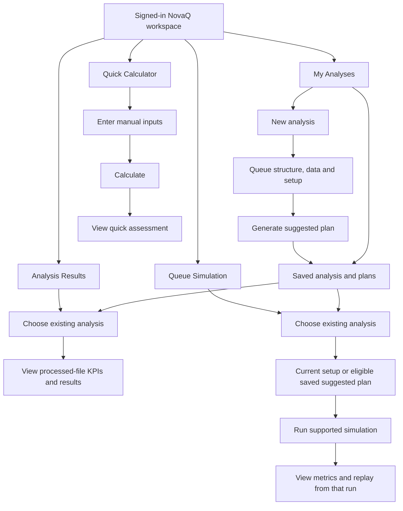

# NovaQ reconstruction after sign-in: implementation plan

Date: 2026-10-15 (Asia/Shanghai).

**Status: PARTIAL.** F1-F4 are implemented and verified on the rebuilt local Docker interface. After reviewing the audit and plan, the owner instructed "lets proceed to this project reconstruction" on 2026-10-15, then separately approved the itemized web-container recreation. That recreation completed; later removals still require their own approval. Commits, pushes and production operations remain unauthorized. The subsequent [runtime/math audit](../reports/2026-10-15-local-runtime-math-audit.md) found M1-M3; its separate remediation plan is PROPOSED only. General reconstruction completion and untested cases are not inferred from the passing gates.

Evidence: [2026-10-15 audit](../specs/2026-10-15-post-sign-in-reconstruction-audit.md). Existing approved design: [compact-workflow spec](../specs/2026-10-09-compact-workflow-ux-redesign.md), especially sections 7.3-7.9; `design-system/novaq/MASTER.md`, sections 9 and 13. Owner-supplied diagram and the explicit after-sign-in-only clarification define the requested scope.

## Outcome

Complete the existing signed-in NovaQ workflow around these four entry points:



This is the requested interaction structure, not a replacement database schema. An existing analysis can be reopened without creating another one. Current results require processed data but do not require a suggested plan. A suggested-plan simulation preserves the existing persisted selection requirement. Missing prerequisites and unsupported settings must be explained, never bypassed.

The diagram's Save stage is satisfied through the existing persisted analysis, setup and scenario operations. Do not postpone analysis creation or claim atomic saving without a separately approved contract change.

## Hard boundaries

- Work only in `.claude/worktrees/ux-workflow-audit`; start by rechecking branch, HEAD and dirty files. Audit baseline: `feat/ux-u1-shell`, `0b9423ec66d32620ed91769ac35a10e51ffae2ec`.
- No Home-page edits, public navigation changes or indirect Home visual changes. No authentication-screen, login/session/CSRF/ownership/role changes.
- No queueing formulas, model-selection dispatch, optimizer objectives, DES/Monte Carlo behavior, Decision derivation, report calculations, schema/migrations or API contract changes.
- Preserve Reports, Decision, Help, Settings and public calculator behavior. Use existing components/styles without changing shared tokens or unscoped selectors.
- New copy must have symmetric EN/TL keys. Translation symmetry is not proof of native-language quality.
- No manufactured observations. Verification data must have an identified source and be explicitly described as test/synthetic data where applicable. Do not modify the pre-existing local analysis 2 or its workbook merely to make a test pass.
- Local only. No commit or push without the owner's separate instruction; never push main, deploy or touch Render/Pages/Supabase.
- No Docker cleanup. Container replacement during a later web refresh must respect the owner's explicit container-removal approval rule; do not treat routine Compose recreation as permission for general deletion.

## Phase 0 — Confirm the implementation scope

1. Re-read this audit, `AGENTS.md`, current project records and applicable design sections. Inspect any changes since the baseline.
2. Treat F1-F4 as the verified remediation targets, with each claim limited to its stated evidence.
3. Keep the approved last-used-analysis convenience when its ID is still owned and unarchived. Otherwise show the appropriate area's picker. An always-show-picker interaction would be a separate owner design choice, not an assumed requirement.
4. Retain the existing workspace footer initially. The Next step panel versus footer detail in the older spec/MASTER needs an explicit design decision before replacement; the business-flow diagram alone does not settle that presentation detail.
5. Obtain the owner's instruction to implement this plan before editing application code. Any required backend, authentication or mathematical change stops the affected phase for a separate scope decision.

Deliverable: agreed frontend scope and file list, with unchanged protected contracts.

## Phase 1 — Make each area directly usable (F1 and F2)

Proposed files:

- `frontend/src/components/layout/navigation.ts`
- `frontend/src/components/layout/Sidebar.tsx`
- `frontend/src/pages/ResultsPage.tsx`
- `frontend/src/pages/ReportsPage.tsx`
- `frontend/src/pages/QueueSimulationPage.tsx`
- `frontend/src/pages/NewAnalysisPage.tsx` for an allowlisted after-create continuation only; preserve its existing create payload and persistence order.
- A new shared authenticated analysis-picker component, exact filename to be established at implementation.
- Related tests and EN/TL locale files. Any new styles must be scoped to that component and must not change Home.

Work:

1. When there is no valid remembered analysis, sidebar links point to their actual areas, not silently to `/analyses`.
2. The area shows its own title and an explicit choice of owned, unarchived saved analyses. Provide distinct loading, failed-request, no-records and no-matching-records states. A failed list request is not an empty account.
3. Selecting a record opens the intended area. A New analysis action from an empty state must have a tested continuation back to that area after creation; limit any continuation parameter to an allowlisted internal destination. Do not modify authentication intent handling.
4. Preserve deep links. A foreign/missing explicit analysis ID displays the existing error/recovery state; do not quietly replace it with another record. Malformed/archived remembered IDs and unavailable storage fall back safely to the picker.
5. On analysis change, clear file/period/line/run references that belong to the previous record. Preserve only compatible view/destination parameters and clear old values while the new context loads.
6. Give every sidebar link its existing translated accessible name in expanded and collapsed modes. Preserve hrefs, current-page state, tooltips and keyboard focus.

Tests must cover fresh account, existing records with no hint, valid/invalid/foreign/archived hint, storage failure, API failure, explicit inaccessible ID, correct target after choice/creation and no stale values. Verify collapsed accessible names in the browser with the real CSS; `css: false` component tests alone are insufficient.

Acceptance: each destination visibly opens its own area or the existing valid last-used analysis. No new analysis is required to reopen saved work. All five collapsed links have names.

## Phase 2 — Complete saved-plan reopening and selection (F3)

Proposed files:

- `frontend/src/components/results/useSelectedPlan.ts`
- `frontend/src/components/results/PlanChanges.tsx`
- Related result/plan-selection tests and EN/TL copy.
- `OptimizePage.tsx`, `QueueSimulationPage.tsx` or a dedicated shared selection component only if necessary for the scoped recovery links; do not alter optimizer requests or saved scenario payloads.

Work:

1. Keep available saved plans visible when no plan has yet been selected. Support the existing shared and separate response shapes.
2. Reuse existing eligibility rules: server-reported currentness and verified complete comparison for shared plans; server-reported valid and non-stale comparison for separate plans. Never infer eligibility solely from a name, ID or saved timestamp.
3. Select only on an explicit Use for simulation action through `selectWorkflowScenario`. Do not generate, duplicate, overwrite or automatically select a scenario.
4. Handle pending, refusal and partial-success states. A plan that saved but failed selection stays saved; expose a real path to retry selection. Refresh the existing workflow/comparison caches on success.
5. Keep current results readable without any plan. Review-only/older-file viewing must continue to avoid planning mutations and unnecessary plan requests.
6. From Suggested simulation with no chosen plan, provide a route to choose an eligible existing plan as well as generate a new one. Do not present the mere existence of a saved record as verified selection.

Tests: shared and separate eligible-but-unselected plans, selection refusal/retry, no eligible plans, stale/historical/foreign/incomplete plans, save-success/selection-failure recovery, reload after selection, analysis changes and review-only files. At least one real local saved-plan reopening must be verified later using an explicitly identified test analysis.

Acceptance: Save without using -> leave/reopen -> choose the existing plan -> simulation receives the persisted selection, without regenerating a plan.

## Phase 3 — Align simulation actions and continuation with their real basis (F4)

Proposed files: `frontend/src/components/queueSimulation/RunBar.tsx`, relevant `QueueSimulationPage.tsx` label props/tests and symmetric locale keys if needed. Browser verification also found a mismatched empty-state instruction in `KeyResultsView.tsx`; align it with the same helper and existing translations. Reuse existing run-basis helpers; do not implement a second model dispatcher.

1. Name a period-by-period action accordingly. Use full-operation wording only for a path that actually uses the supported continuous operation basis.
2. Preserve Current versus Suggested, operating hours, closing rules, seeds, repeats, recorded service-time assumptions, break limitations and all run parameters exactly.
3. Keep the distinction between Not run, a stored run, Running, stale evidence, a failed/refused run and a current Decision. Never label a step complete from a route visit or from local UI state alone.
4. Verify Key results, Replay and Checks preserve analysis/run context. Metrics and replay must refer to the same stored run. Missing totals remain Unavailable.
5. Check transitions from My Analyses, Data and setup, Suggested plans, Results and Simulation. Add context-specific recovery links where an audited gap requires them; retain existing canonical routes and footer behavior.

Acceptance: labels and available actions match the existing run basis. No new simulation capability, full-day customer total or Decision is implied by a UI change.

## Phase 4 — Verify the whole reconstructed workflow

Run this matrix for both One shared queue and Separate queues, within existing engine support. Use isolated, clearly identified local test analyses and documented fixtures; identify input units, dataset purpose, periods and limits. Do not invent a dataset to claim success or overwrite existing local records. If a required case is unavailable or unsafe under current memory, report NOT TESTED or stop the affected gate.

| Area | Required observed outcome |
|---|---|
| New / saved analysis | Create the supported structure, persist its setup, leave and reopen the same record. Existing work is selectable without another create operation. |
| Data | Preview, upload/process a known fixture, distinguish planning and review-only data, report validation/refusal honestly, and reopen the same file. |
| Results | Correct analysis/file context; provenance labels; honest no-data state; current results before selecting any plan; unavailable values never replaced with invented zeroes. |
| Suggested plans | Generate through the real API, save, leave/reopen, select an eligible existing plan; preserve stale/refused behavior and save/selection partial failure. |
| Simulation | Current and selected Suggested where supported; accurate action name, prerequisites and refusal messages; run once; inspect saved metrics and Replay; do not claim mathematics independently verified from a successful response. |
| Checks / Decision / Reports | Preserve existing required evidence and freshness. Exercise allowed Decision/report flows and refused exports; do not loosen the gates to reach a green screen. |
| Quick Calculator | Signed-in manual-input calculation through its existing endpoint, validation and server refusal; no analysis record required. Preserve the public calculator behavior. |
| Access / usability | Own/foreign/missing/archived IDs, list failures, keyboard-only navigation, collapsed names, EN/TL, light/dark and 375/768/1024/1440 widths. Record actual results individually. |
| Home boundary | Final file diff excludes Home/auth/public navigation. Review styles and shared imports for indirect effects; establish no out-of-scope edits. |

Automated gates, sequentially (do not overlap test/build workloads):

```powershell
# frontend directory
npm test -- --maxWorkers=1
npm run typecheck
npm run lint
npm run build
```

Run repository-required regression gates using the known virtualenv Python and installed tools, not bare system pytest:

```powershell
# worktree root; verify this interpreter and its installed tools before running
$taskPython = 'C:\Users\Administrator\Desktop\QUEUING_THEORY_NOVAMART\NovaQ\.venv\Scripts\python.exe'
& $taskPython -m pytest tests/ -x --tb=short
& $taskPython -m ruff check .
& $taskPython -m mypy .
```

Resolve or explicitly block on failed gates; never change expectations or inflate timeouts merely to hide a failure. Retain the earlier combined unknown-Settings redirect failure as an investigation item until a reproducible cause or sufficient explicit verification addresses it. Targeted passes are not a full-suite pass.

No mathematical change is planned. If any becomes necessary, stop that change for separate authorization, approved equations/assumptions, independent reference cases and numerical regression verification.

## Phase 5 — Rebuild the local preview after implementation and gates

This phase is NOT PERFORMED by the audit. Recheck memory before every heavy step; run one build at a time. Keep a full log and elapsed time.

1. Read host free memory, `docker info --format "{{.MemTotal}}"`, VM available memory where accessible, local Compose status and resource usage. Do not infer that total VM allocation equals free memory. If memory evidence is unavailable, mark UNKNOWN and choose a bounded safe next action.
2. Confirm the actual changed services. For the proposed frontend-only work, build only web with `docker compose build web`; no API/migrate/bootstrap rebuild should be needed unless a separately approved scope change requires it.
3. On build failure, show the actual last 40 log lines, explain only what the log establishes and stop. Do not prune images, containers, volumes or cache to work around a failure.
4. Before replacing an existing web container, follow the owner's removal rule: identify the exact `ux-workflow-audit-web-1` container from a fresh inspect, report its measured writable-layer size and any UNKNOWN net space recovery, and obtain explicit approval for that specific recreation. No general Docker deletion is authorized.
5. Once that bounded replacement is authorized, refresh web through Compose without restarting dependencies (`docker compose up -d --no-deps web`). Recheck `docker compose ps -a`, `/healthz` and `/api/health`, then verify the changed browser flows against the new image. Keep database contents.
6. Report the actual image build, duration, final Compose status, browser evidence and every failed/unexecuted check. A green health endpoint alone is not completion of the reconstruction.

No commit, CI push, merge or production release is part of these phases without separate owner authorization.

## Completion and report

Reconstruction is complete only when the agreed after-sign-in flow works with persisted records, the applicable gates pass, the actual rebuilt local interface is verified and material unknowns are closed or explicitly accepted as scope limits. Page structure alone is not completion.

Final report must state verified findings, exact modified files, executed results (including failures), unresolved defects, NOT TESTED/UNKNOWN items and any scope deviation. The Home page must remain untouched.
